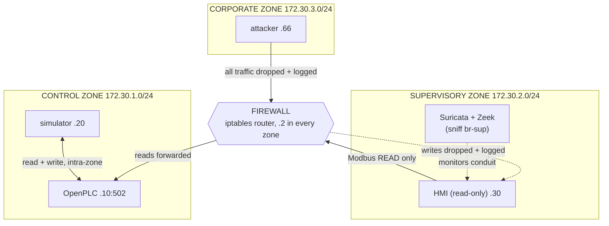

# ics-security-lab

A self-contained **industrial control system (ICS) security lab** that runs on
Docker. A real PLC runtime (OpenPLC) controls a simulated water tank over
Modbus/TCP; a web HMI reads it; an attacker container performs recon, command
injection, false-data injection, and replay against it; and Suricata + Zeek
detect the traffic. A second build splits the lab into **three security zones
with an iptables firewall conduit**, turning the project from "detect the
attack" into a defence-in-depth story — detection on a flat network, prevention
with segmentation — backed by a reproducible experiment harness. The whole thing
comes up with one command and never touches a real network.

> **Lab use only.** Everything runs on isolated Docker networks on your own
> machine. The attack scripts are hard-scoped to the lab's PLC and refuse any
> other target — never point them at real equipment. See
> [`attacker/README.md`](attacker/README.md).

## Architecture

The segmented build models an ICS network as zones joined by a single, tightly
controlled conduit:



- **PLC** — OpenPLC_v3 running a hysteresis pump controller in IEC 61131-3
  Structured Text ([`plc/tank_control.st`](plc/tank_control.st)), with HI/LO
  alarms and a latched HIHI trip.
- **Process simulator** — a Python model of the tank on a 100 ms timestep; it
  reads the pump coil and writes the level register back over Modbus
  ([`simulator/`](simulator/)).
- **HMI** — a read-only Flask app that polls the PLC and shows a live gauge,
  alarm panel and trend ([`hmi/`](hmi/)).
- **Attacker** — pymodbus + scapy scripts ([`attacker/`](attacker/)).
- **Detection** — Suricata with the Modbus parser and custom rules, plus Zeek's
  Modbus analyzer; `alerts.py` tails the alerts into a clean table
  ([`detection/`](detection/)).
- **Firewall** — an iptables router between the three zones
  ([`firewall/`](firewall/)).

Full write-up, zone addressing, and the mapping to **CSA N290.7** (defence in
depth) and **IEC 62443** (zones & conduits): [`docs/architecture.md`](docs/architecture.md).

## Quick start

```bash
make up       # build and start the flat lab
make verify   # end-to-end check of the PLC/simulator loop (~30-60 s)
make logs     # follow logs (make logs S=simulator for one service)
make down     # stop
```

- OpenPLC UI: http://127.0.0.1:8080 — upload `plc/tank_control.st` and start the PLC
- HMI: http://127.0.0.1:8000

Run the **segmented, defence-in-depth** build instead with:

```bash
docker compose -f docker-compose.segmented.yml up -d --build
```

Requires Docker with Compose v2. Suricata and Zeek sniff the lab bridge from the
host network namespace (works on Linux and Docker Desktop).

## Attacks and detection

Each attack maps to a Suricata rule; in the segmented build the firewall also
blocks the ones coming from the corporate zone. Full results, including measured
time-to-detect, are in **[`docs/results.md`](docs/results.md)**.

| Attack | Technique | Detected (Suricata) | Blocked with zones |
|---|---|---|---|
| `recon.py` | ARP sweep + Modbus register enumeration | yes (sid 1000004) | yes |
| `pump_override.py` | unauthorized coil write | yes (sid 1000001) | yes |
| `sensor_spoof.py` | false-data injection on the level register | yes (sid 1000002) | yes |
| `replay.py` | capture Modbus to pcap and replay it | yes (sid 1000004) | yes |

Regenerate the results on your machine with `python3 run_experiments.py`, which
runs every attack under both topologies and writes `docs/results.md`.

## Lessons learned

- **Modbus trusts anyone who can reach it.** No auth, no sessions — so the real
  controls are network segmentation and monitoring, not the protocol.
- **Writing a PLC output rarely "sticks."** The PLC re-drives its outputs from
  its own logic every scan, so a forced coil is overwritten within ~20 ms. The
  damaging attack is lying to the controller's *inputs* (the sensor spoof), not
  commanding its outputs — which is the Stuxnet pattern.
- **L3/L4 firewalls can't see Modbus function codes.** Enforcing "HMI may read
  but not write" needed a `u32` byte-match on the function code at the conduit —
  exactly why OT networks want protocol-aware filtering, not just port rules.
- **Segmentation changes what the IDS can see.** Once the firewall drops the
  corporate attacker, the supervisory sensor never sees it — the firewall log
  becomes the detection source. Sensor placement is a design decision, not an
  afterthought.
- **Sensors belong on a tap, not a bridge.** A container on a Docker bridge only
  sees its own traffic, so Suricata/Zeek run in the host netns and sniff the
  bridge directly.

## Extending it

- Add protocol-aware detection rules (e.g. alert on any write to the level
  register from a non-simulator host) and measure the false-positive rate.
- Put a sensor **inside** the control zone to regain visibility the segmentation
  removes, and compare coverage.
- Add a historian / data-diode DMZ between corporate and supervisory to model
  the full Purdue hierarchy.
- Swap Modbus for an authenticated transport (e.g. Modbus/TCP over TLS, or
  OPC UA) and show which attacks stop working.
- Drive the experiment harness from CI so results.md is regenerated on each change.

## Skills demonstrated

- **Modbus/TCP** — protocol internals (function codes, MBAP framing, the
  register/coil map), client tooling with pymodbus, and byte-level packet
  matching.
- **PLC programming** — IEC 61131-3 Structured Text: hysteresis control,
  alarms, and a latched safety trip, compiled and run on OpenPLC.
- **Suricata** — Modbus app-layer parsing, custom rule writing (keyword and raw
  `u32`/content matches), and `eve.json` analysis.
- **Zeek** — the built-in Modbus analyzer and transaction logging.
- **Network segmentation** — zones & conduits with an iptables routing firewall,
  default-deny, SNAT, and function-code filtering, mapped to IEC 62443 / CSA N290.7.
- **Docker** — multi-service Compose, multiple bridge networks, host-netns
  sensors, build-from-git, capabilities, and a reproducible multi-topology harness.
- **Python** — the process simulator, the HMI service, the attack tooling, and
  the experiment runner, with unit tests for the physics and the HMI.

## Repository metadata

**Suggested one-line description:**
> Docker ICS/OT security lab — OpenPLC + Modbus water-tank process, attacks, and Suricata/Zeek detection, with a segmented defence-in-depth build.

**Suggested topics:** `ics-security` `ot-security` `scada` `modbus` `openplc`
`plc` `suricata` `zeek` `intrusion-detection` `network-segmentation`
`defense-in-depth` `iec-62443` `docker` `cybersecurity`

## License

MIT, see [LICENSE](LICENSE).
