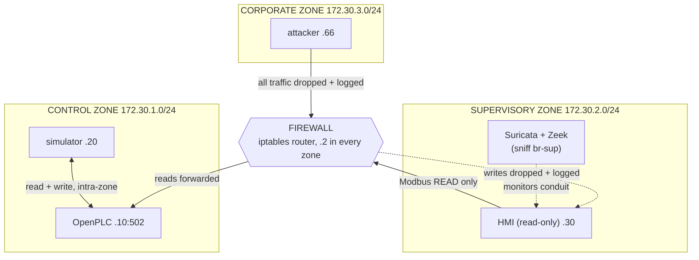

# Architecture

The lab can run in two topologies:

- **Flat** (`docker-compose.yml`) — every service on one Docker network. Simple,
  and what the attack/detection walkthroughs assume.
- **Segmented** (`docker-compose.segmented.yml`) — three security zones with a
  firewall between them, described below. This is the defence-in-depth version.

Switch with `-f`:

```bash
docker compose -f docker-compose.segmented.yml up -d --build
```

## Zones and addressing (segmented)

| Zone | Subnet | Hosts | Role |
|---|---|---|---|
| **control** | 172.30.1.0/24 | openplc `.10`, simulator `.20` | the process: PLC + the physics that drives it |
| **supervisory** | 172.30.2.0/24 | hmi `.30`, Suricata + Zeek (host netns) | operators and monitoring |
| **corporate** | 172.30.3.0/24 | attacker `.66` | general IT — stands in for the untrusted business network |
| (all three) | `.2` in each | firewall | routes between zones and enforces the conduit policy |

The **simulator writes the PLC from inside the control zone**, so that traffic
never touches the firewall. Everything that crosses a zone boundary goes through
the firewall.

## Zone diagram



## The conduit policy

The firewall's default for inter-zone traffic is **drop**. Exactly one flow is
allowed across a boundary:

1. **supervisory HMI → control PLC, Modbus/502, reads only.** The TCP handshake
   and Modbus read function codes pass; write function codes (5, 6, 15, 16, 22,
   23) are dropped by inspecting the function-code byte in the request (a `u32`
   match at TCP payload offset 7). The flow is source-NATed so the PLC can reply
   without a route back into the supervisory zone.
2. **Everything else between zones is dropped and logged** — the whole corporate
   zone (the attacker), any non-Modbus HMI traffic, any write from the HMI.

"Only the simulator may write" is enforced by **placement**: the simulator is
the sole control-zone client, and the only other party that could write — the
HMI — is in another zone whose writes the firewall drops. The attacker has no
allowed conduit to the control zone at all.

### What happens to each actor

| Actor | Tries to | Result |
|---|---|---|
| simulator | read + write PLC | allowed — intra-zone, never sees the firewall |
| HMI | read PLC level/coils | allowed through the conduit |
| HMI | write PLC | dropped + logged (and, if a sensor sees it, alerted) |
| attacker | reach the PLC or HMI | dropped + logged at the firewall; ARP recon sees only its own empty zone |

## How this maps to the standards

### Defence in depth — CSA N290.7

CSA N290.7 (cyber security for Canadian nuclear facilities) is built on
**defence in depth**: protection should come from *multiple independent layers*,
so that the failure or bypass of any one layer does not expose the asset, and
controls are applied with a **graded approach** — the more severe the potential
consequence, the stronger and more numerous the layers. The standard also frames
systems in terms of security levels/zones with deliberately controlled
interfaces between them.

This lab is a small model of that idea. No single control is trusted to stop an
attacker reaching the PLC; instead the protections stack:

- **Segmentation** — the attacker is in a separate zone with no conduit to the
  process (the firewall drops it). This is the outer layer.
- **Least-privilege conduit** — the one allowed cross-zone flow is narrowed to
  read-only Modbus from a single host, so even a *trusted* neighbour cannot
  write the PLC.
- **Monitoring** — Suricata and Zeek watch the conduit, and the firewall logs
  every drop, so a layer that is probed or bypassed is still *seen*.
- **The controller itself** — the PLC re-drives its outputs from its own logic
  every scan, so a stray write that did get through is overwritten, and the
  program's HIHI trip is an independent safety reaction.

The graded idea shows up in where the strength is concentrated: the control zone
(highest consequence — it moves the pump) gets the strictest interface, while
the corporate zone is treated as untrusted by default.

### Zones and conduits — IEC 62443

IEC 62443 formalises exactly this structure. Assets are grouped into **zones**
that share a security requirement, and every communication path between zones is
a **conduit** that must enforce an explicit policy; anything not expressly
permitted through a conduit is denied. Risk assessment (IEC 62443-3-2) assigns
each zone a target **security level**, and the conduit between two zones is
engineered to meet it.

Mapping the model onto the lab:

- **Zones** — control, supervisory, corporate, each its own Docker network.
  Their trust decreases outward: the control zone is the crown jewel, the
  corporate zone is assumed hostile.
- **Conduit** — the firewall is the single conduit between supervisory and
  control, carrying one allowed service (Modbus read) under an explicit
  allow-list, default-deny policy. There is deliberately **no conduit** from
  corporate to control or supervisory.
- **Least route / least service** — the conduit permits one protocol, one
  direction, one operation (read), from one host. That is the "as restrictive as
  possible" conduit the standard asks for, and it is why the sensor-spoof and
  pump-override writes, and all attacker traffic, are stopped at the boundary.

A real plant would add more (authenticated protocols, a data diode or hardened
DMZ between IT and OT, patch and account management); the lab captures the
*shape* — zones with a single, tightly scoped, monitored conduit.

## A note on monitoring placement

Segmentation changes what a sensor can see, which is itself a defence-in-depth
lesson. The sensors sit in the supervisory zone and sniff `br-sup`, so they see
the **HMI↔PLC conduit** — including an HMI that tries to write (a compromised
operator station), which the segmented rules flag while the firewall drops it.
They do **not** see intra-control traffic (simulator↔PLC) or the corporate
attacker, because the attacker is blocked at the firewall and its packets never
reach the supervisory bridge. In the segmented lab the **firewall log** is the
detection source for corporate attacks, and full control-zone visibility would
need a sensor placed in (or a tap into) the control zone. The flat lab, with one
bridge, sidesteps this by letting the host-netns sensors see everything.

## Modbus address map

OpenPLC_v3 uses a fixed mapping from IEC addresses to Modbus data addresses
(0-based). The values the lab uses:

| Signal | IEC address | Modbus table | Address | Written by | Notes |
|---|---|---|---|---|---|
| Pump command | `%QX0.0` | Coil | 0 | PLC | 1 = pump running |
| Tank level | `%MW0` | Holding register | 1024 | simulator | 0-1000 = 0.0-100.0 % |
| HI alarm | `%QX0.1` | Coil | 1 | PLC | level >= 85 % |
| LO alarm | `%QX0.2` | Coil | 2 | PLC | level <= 15 % |
| HIHI trip | `%QX0.3` | Coil | 3 | PLC | latched at >= 95 % |
| Operator reset | `%QX0.4` | Coil | 4 | HMI | write 1; PLC clears it |

Why `%MW0` and not an input register (`%IW`): Modbus input registers are
read-only for clients, so the simulator couldn't write one. `%MW` is a
read/write holding register the PLC program reads like a sensor value. All `%QX`
coils are writable by any Modbus client; the PLC recomputes outputs every scan,
so only `op_reset` is meant to be written externally. Coil address = byte × 8 +
bit, so `%QX0.1` is coil 1 and `%QX1.0` is coil 8.

## Running the segmented lab

```bash
docker compose -f docker-compose.segmented.yml up -d --build
docker compose -f docker-compose.segmented.yml logs -f firewall   # watch rules load + drop counts
```

Then, to see the conduit policy in action:

- The HMI at http://127.0.0.1:8000 should still show live level/pump data
  (reads cross the conduit).
- From the attacker, the attacks should now **time out**, and the firewall
  should log the drops:
  `docker compose -f docker-compose.segmented.yml exec attacker python sensor_spoof.py`

> **Status:** the segmented topology is a design that has not yet been run
> end-to-end. The firewall routing (per-zone routes + SNAT), the `u32`
> write-filter, and the sensor placement each want live validation before you
> rely on them. The flat lab remains the verified reference.
